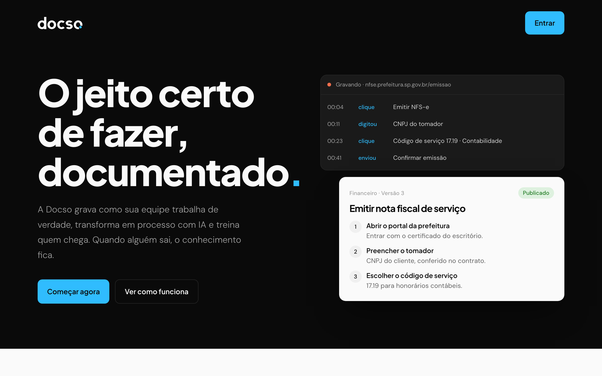

# Docso

SaaS B2B para pequenas e médias empresas brasileiras (5 a 50 pessoas) que documenta processos com IA, treina a equipe e guarda o conhecimento quando alguém sai.

Este repositório tem só a página de apresentação do produto (`index.html`). O código da aplicação fica em um repositório privado; abaixo está o que foi construído nele.

## O que o produto faz

- **Documenta**: uma extensão do Chrome grava a pessoa executando a tarefa (cliques, campos, envios). Uma conversa guiada por IA completa o que não aparece na tela, e o resultado vira um processo em etapas para revisão.
- **Treina**: o gestor atribui processos a pessoas da equipe, que recebem o link por e-mail, fazem um quiz e têm a execução validada na prática.
- **Retém**: cada processo tem versão, setor dono, fluxo de aprovação (gerente edita, admin publica), POP em PDF e registro de treinamento para auditoria.

## O que eu construí

- **Multi-tenant de ponta a ponta**: toda tabela tem `organizationId`, RLS ativo no Postgres e o backend só lê a organização do JWT, nunca do corpo da requisição.
- **Autenticação com Supabase Auth**: um hook de Custom Access Token injeta organização e papel (admin, manager, member) no token, e a API valida o JWT via JWKS com `jose`.
- **Extensão Chrome (Manifest V3)**: gravação manual de eventos do DOM, com service worker mantido ativo por `chrome.alarms`.
- **IA aplicada ao fluxo**: mapeamento conversacional, geração de processo a partir da gravação e geração de quiz com Claude Haiku 4.5, com cache por hash do input e limite mensal por plano.
- **Treinamentos**: links com token opaco, quiz que mostra o que a pessoa errou sem entregar o gabarito, lembretes por e-mail e painel de análise.
- **Operação**: e-mails transacionais com layout único (Resend), monitor externo em `/health`, painel interno de administração e onboarding de empresas por link.

## Stack

| Camada | Tecnologia |
|---|---|
| Frontend | React 19, TypeScript, Vite, TanStack Router e Query, Tailwind CSS 4, shadcn/ui |
| Backend | Hono, Node.js, Prisma |
| Banco e auth | Supabase (PostgreSQL com RLS, Auth) |
| IA | Anthropic Claude Haiku 4.5 |
| Extensão | WXT, React, Manifest V3 |
| Infra | Cloudflare (front), Render (API), Cloudflare R2, Resend |

## Ver a página

Abra o `index.html` no navegador. A página não tem build nem dependências.
